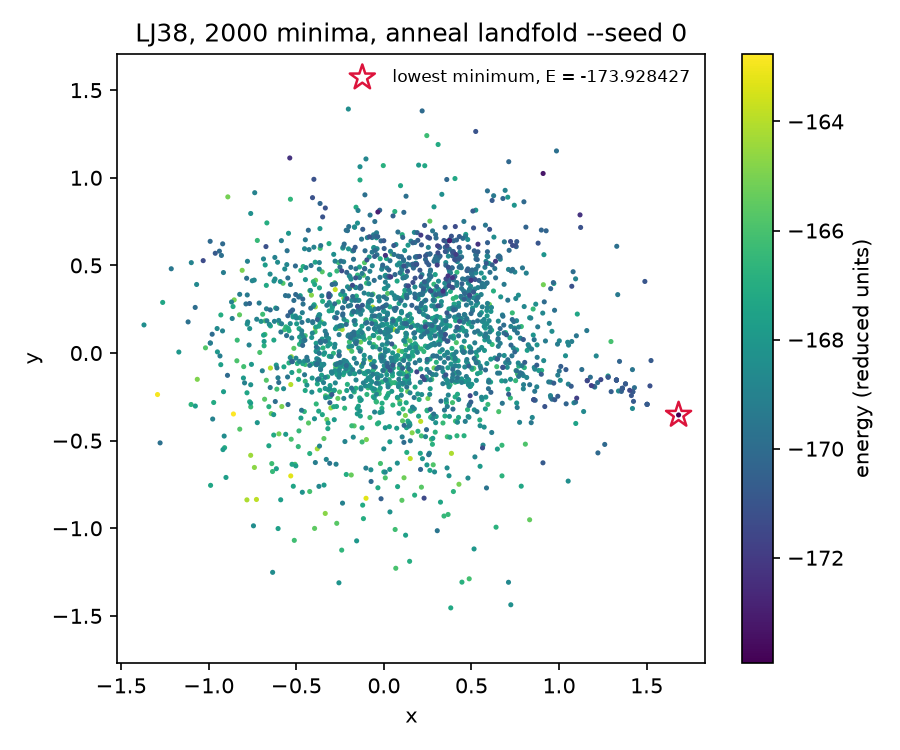

#+TITLE: Map a minima book with landfold
#+OPTIONS: toc:nil todo:nil num:nil author:nil ^:nil

=landfold= places every minimum of a book on the plane by landmark sketch-map.
Funnels and structural families separate, near-identical minima stay together, and minima found later can be added without moving the old ones.
A seed fixes the map bit for bit at any thread count.
The @@rst::doc:`landfold survey </explanation/landfold-survey>`@@ explains the choice of method and gives the benchmark.

* Inputs

A book is a =.min= dump, one minimum per line with the energy and then 3N coordinates, or a multi-frame =.xyz= file.
Each minimum becomes one row of a packing-identity descriptor.
The descriptor comes from the Descriptor Embedding and Clustering for Atomistic-environment Framework (DECAF).
A row is the class histogram of the atoms of a minimum on one codebook shared by the book.
Rows are compared by L1 distance.
Any other descriptor matrix can be folded directly.

If you have no book at hand, the =landfold_lj_book= example writes one.
It is the 38-atom Lennard-Jones (LJ38) book of the benchmark, with 2000 distinct minima from seed 38.
Run the example from the repository root:

#+begin_src sh
cargo run --release --example landfold_lj_book -- 38 2000 38 lj38.min \
    tests/fixtures/lj38_fcc.xyz tests/fixtures/lj38_ico.xyz
#+end_src

* Command line

#+begin_src sh
cargo build --release --bin anneal
target/release/anneal landfold lj38.min --seed 0 --out lj38.csv
target/release/anneal landfold lj38.min --seed 0 --out lj38.json --dump-descriptors lj38.desc.csv
target/release/anneal landfold --descriptors lj38.desc.csv --out again.csv
#+end_src

If you pass more than one book, landfold reads them in order and folds them as one.
The comma-separated values (CSV) output has one row per minimum, in book order.
Its columns are =index,energy,x,y,landmark,family,community=.
=landmark= is 1 for a landmark.
=family= and =community= are the DECAF family and occupied-class community.
=community= is empty when a minimum has none.

The JavaScript Object Notation (JSON) output is a single object.
It has =kind= ("landfold"), =n=, =landmarks=, =sigma=, =sigma_low=, =high=, =low=, =stress=, =spectrum= and =points=.
Each point carries the CSV fields.
The output format follows the extension of =--out=, or =--format csv|json=.

The =--dump-descriptors= output parses back to equal doubles.
Folding that file with =--descriptors= therefore gives the map of the book bit for bit.

The options below control how landfold folds a book.

| option             | default          | meaning                                       |
|--------------------+------------------+-----------------------------------------------|
| =--seed N=         | 0                | first landmark and eigensolve start           |
| =--landmarks M=    | 400              | farthest-point landmarks                      |
| =--sigma S=        | auto             | high-dimensional switch scale                 |
| =--sigma-scale F=  | 0.5              | auto sigma as F times median landmark distance |
| =--sigma-low S=    | sigma            | map switch scale                              |
| =--high A,B=       | 2,4              | high-dimensional switch exponents             |
| =--low a,b=        | 2,4              | map switch exponents                          |
| =--grid G=         | 21               | grid nodes per axis; 0 skips the grid         |
| =--iterations K=   | 200              | L-BFGS iterations per stage                   |
| =--mix M1,...=     | 1,0.5,0.25,0.1,0 | raw-distance weight of each stage             |
| =--weight-power G= | 0.5              | landmark weight is Voronoi population to G    |
| =--metric l1/l2=   | l1               | row distance                                  |
| =--threads T=      | all cores        | worker threads                                |

A summary on standard error gives sigma, the final stress, and the read and fold times.
It also gives lambda1 and lambda2 of the landmark multidimensional scaling (MDS) start.
=-q= drops it.

* Plot the map

Any plotting tool can read the =x=, =y= and =energy= columns of the CSV.
The figure below comes from =docs/figures/landfold/plot_map.py=, which writes the LJ38 book above, folds it with =anneal landfold --seed 0= and plots =x= against =y= coloured by =energy=.
Run it from the repository root, with matplotlib installed:

#+begin_src sh
cargo build --release --bin anneal --example landfold_lj_book
python docs/figures/landfold/plot_map.py
#+end_src

#+CAPTION: The LJ38 book folded by =anneal landfold --seed 0= and coloured by energy, with a star on the lowest minimum.

* Python

#+begin_src python
import anneal

fold = anneal.landfold_book("lj38.min", seed=0)
x, y = fold["xy"].T
energy = fold["energy"]

more = anneal.landfold(new_rows)               # any (n, D) array
placed = fold["map"].project(new_book_rows)    # held-out rows, (k, 2)
#+end_src

Both calls take the options of the command-line interface (CLI) as keywords.
These include =landmarks=, =sigma_scale=, =high= and =threads=.
They return a dict with =xy=, =landmarks=, =sigma=, =sigma_low=, =high=, =low=, =stress=, =spectrum= and =map=.
=landfold_book= adds =energy=, =rows=, =family= and =community=, with -1 for no community.
=map.project= places rows against the fixed landmarks, and =map.landmark_xy= and =map.weights= expose the fit.

* Rust

#+begin_src rust
use anneal_core::landfold::{LandfoldConfig, book_descriptors, landfold, read_book};

let book = read_book("lj38.min".as_ref())?;
let coords: Vec<Vec<f64>> = book.iter().map(|m| m.coordinates.clone()).collect();
let rows = book_descriptors(&coords)?;
let fold = landfold(&rows.rows, &LandfoldConfig { seed: 0, ..LandfoldConfig::default() })?;
let new_xy = fold.map.project(&rows.rows[0]);
#+end_src

=Landfold= has =xy=, =landmarks=, =map=, =stress= and =spectrum=.
=LandfoldMap::project= and =project_distances= place one new row.
=farthest_point_landmarks= and =classical_mds= are public for other uses.

* Snakemake

In the anneal_repro workflow, =landfold/Snakefile= runs the CLI per book in its =landfold_coords= rule.
The rule writes =results/maps/{book}.csv=.
