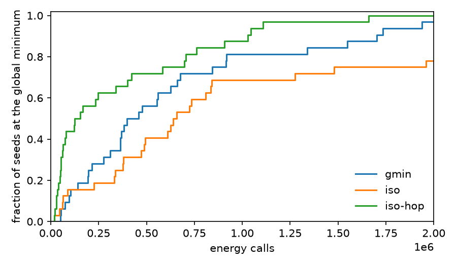

#+TITLE: Compare Search Arms on a Sutton-Chen Cluster
#+OPTIONS: toc:nil todo:nil num:nil author:nil title:nil ^:nil

#+begin_export rst
=============================================
Compare Search Arms on a Sutton-Chen Cluster
=============================================
#+end_export

This guide shows how to run =examples/sc_h2h.rs= over a range of seeds, score the arms, and compare them with another code.
The [[file:../tutorials/sutton-chen-shelf.org][Sutton-Chen shelf tutorial]] introduces that runner, so read it first.

* Choose an arm

Start by choosing which of the four arms to run.
Each of them runs arm 3, the orbit-completion search, in Cambridge reduced units.
The Metropolis temperature is the published basin-hopping temperature of the row.

| arm       | chains | surface hops |
|-----------+--------+--------------|
| =iso=     |      1 | no           |
| =ens=     |      4 | no           |
| =iso-hop= |      1 | yes          |
| =ens-hop= |      4 | yes          |

The =ens= chains split the budget and share one exact minimum history.
They take turns, so a run repeats exactly on one thread.
Surface hops are =Config::surface_hop_on_best=, described in the [[file:../methods/catalog.org][method catalog]].

* Give every code the same starts

A fair comparison starts both codes from the same structures.
The runner reads its start from a Cartesian coordinate (XYZ) file with =n= atoms.
Store one start per seed and pass the same file to the other code.
Then the two codes differ only in their search.

* Run a seed range

To run an arm over a seed range, pass the arm, the row, the size, the energy-call budget, the seed, the start and the reference energy.
The reference only decides when a run stops.
A run hits once a validated quench is at or below the reference plus 0.001.

#+begin_src bash
mkdir -p runs/iso-hop
for seed in $(seq 9532 9563); do
  cargo run -q --release --example sc_h2h -- iso-hop 9-6 78 2000000 $seed \
    starts/n78/seed$seed.xyz -19054.3977 > runs/iso-hop/seed$seed.out
done
#+end_src

* Read one run

To read a run, look up the keys it prints.
Each output line is a key and a value, and the keys below answer most questions.

- =hit= :: Its value is =true= once a validated quench reaches the reference window.
- =hit_calls= :: Energy calls spent before the hit.
- =hit_minimisations= :: Full quenches done by that point.
- =best= :: Lowest validated energy.
- =full_quenches= :: Full quenches over the whole run.
- =screen_calls= :: Calls spent on short screening descents.
- =surface_hops= :: Surface-hop candidates quenched.
- =surface_descents= :: Sweeps that lowered the record.
- =resolved_sha256= :: Digest of the resolved configuration.

The digest changes only when the configuration does.
The output repeats for two runs with the same digest, start and seed.

* Score and plot the arms

To score the arms, pass one directory per arm to =docs/scripts/plot_sc_hits.py=.
The script also reads one JavaScript Object Notation (JSON) file per seed from another code, with the keys =hit= and =calls_at_hit=.
It prints the hits, the median calls to hit, the mean penalised average runtime with factor 2 (PAR-2) and a paired p-value against the first label.
PAR-2 charges a miss twice the budget.
The p-value comes from a two-sided sign-flip test on the per-seed PAR-2 differences.

#+begin_src bash
python3 docs/scripts/plot_sc_hits.py 9532 9563 2000000 hits.png \
  gmin=runs/gmin iso=runs/iso iso-hop=runs/iso-hop
#+end_src

#+begin_example
label hits median_calls_to_hit mean_par2 paired_p
gmin 31/32 398438 704181 -
iso 25/32 494364 1330466 0.0596
iso-hop 32/32 138950.5 355139 0.0436
#+end_example

#+CAPTION: Fraction of the 32 evaluation seeds of 9-6 N=78 at the global minimum against energy calls, for Wales's global minimisation program (GMIN) and two anneal arms.

Here =runs/gmin= has the results of Wales's global minimisation program (GMIN) on the same 32 starts.
On all 32 seeds =iso-hop= reaches the global minimum, with a median of 138950.5 calls.
GMIN needs a median of 398438 calls and solves 31 seeds.
=iso= stops short on 7 seeds.
When a curve rises earlier, its arm solves more seeds at a smaller budget.
The paired p-value comes from a sign-flip test on the per-seed differences.
The test flips the sign of each seed's difference at random.
It then counts how often the flipped mean is at least as large as the observed one.
A small value means the gap is unlikely to come from the seeds alone.

* Split the cost

To see where a gap in calls comes from, split the calls to hit into two factors.
Calls to hit are quenches to hit times calls per quench.
Divide =hit_calls= by =hit_minimisations= for the calls per full quench.
That figure includes the screening calls, which are a small share for these rows.
Even with cheaper quenches, a code can still lose when it needs more of them.
