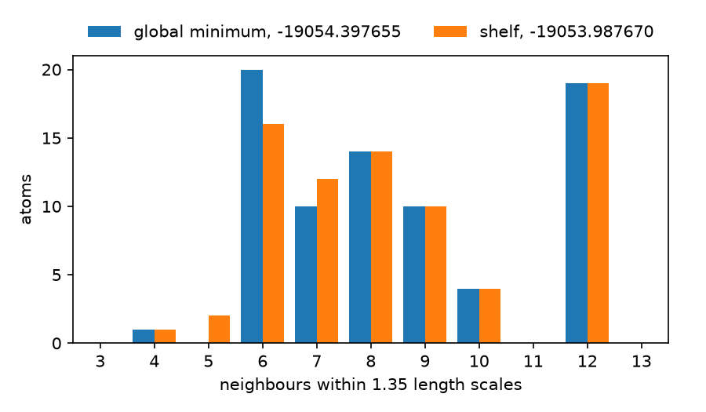

#+TITLE: Why a Sutton-Chen Search Stops Short
#+OPTIONS: toc:nil todo:nil num:nil author:nil title:nil ^:nil

#+begin_export rst
=====================================
Why a Sutton-Chen Search Stops Short
=====================================
#+end_export

In this tutorial you run one search on a 78-atom metal cluster that ends above the global minimum.
You record every minimum it found, look at the lowest ones, and see that the search stopped on a surface defect.
Then you run the same search with surface hops and watch it reach the global minimum.

The cluster is the 9-6 Sutton-Chen row with 78 atoms, in Cambridge units.
The Cambridge Cluster Database lists its global minimum at -19054.3977.
The search uses that number only to stop.

* Build the two programs

First, build the runner and the reader from the repository root.

#+begin_src bash
cargo build --release --example sc_h2h --example sc_minima
#+end_src

The start is a random 78-atom cluster stored with this page.

#+begin_src bash
START=docs/orgmode/tutorials/starts/sc96-78-seed20003.xyz
SIG=7d6d13bd2eaac63b9bbd156cd516df4ba45fb4ac881cf083f3377c937cd071a5
#+end_src

=SIG= is the digest the runner prints as =minima_signature= for this row and size.

* Record the minima of one run

Start with =iso=, one chain of arm 3, the orbit-completion search.
The variable =ANNEAL_MINIMA_DB= names the directory that receives every minimum it finds.

#+begin_src bash
ANNEAL_MINIMA_DB=db cargo run -q --release --example sc_h2h -- \
  iso 9-6 78 2000000 20003 $START -19054.3977 > iso.out
grep -E '^(spent|best|hit):' iso.out
#+end_src

#+begin_example
spent: 2000000
best: -19053.9876701442
hit: false
#+end_example

The chain spent its two million energy calls and stopped 0.41 above the global minimum.

* List the lowest minima

Next, read the minima back to see where the chain stopped.
=sc_minima= groups them by energy.
Pass it the temperature and the length scale the run printed, after the system name.

#+begin_src bash
cargo run -q --release --example sc_minima -- db $SIG sc9-6-78 10 0.6299605249 3 xyz
#+end_src

#+begin_example
system: sc9-6-78
frames: 12894
chains: 1
distinct: 6185
energy chains bonds 555 421 422 other coordination(z:count)
-19053.987670 1 332 4 94 69 165 4:1,5:2,6:16,7:12,8:14,9:10,10:4,12:19
-19053.622897 1 332 4 94 69 165 4:1,5:2,6:14,7:16,8:12,9:10,10:4,12:19
-19052.995717 1 332 4 96 70 162 4:1,5:2,6:16,7:13,8:13,9:10,10:3,11:1,12:19
#+end_example

The chain found 6185 distinct minima.
The columns 555, 421 and 422 count bonded pairs by their common-neighbour signature.
Icosahedral pairs read 555, close-packed pairs read 421, and twin-plane pairs read 422.
The last column says how many atoms have each number of neighbours.
By those counts, the three lowest minima have the same bond count and almost the same signatures.
They differ in how the surface atoms are spread.

* Run the chain again with surface hops

Now rerun the same chain with surface hops and see whether it reaches the global minimum.
=iso-hop= is that chain with surface hops.
Each time the record falls, it tries every least-bound atom on every empty hollow site where the atom keeps its neighbours.
Write its minima to a second directory.

#+begin_src bash
ANNEAL_MINIMA_DB=db-hop cargo run -q --release --example sc_h2h -- \
  iso-hop 9-6 78 2000000 20003 $START -19054.3977 > hop.out
grep -E '^(surface_hops|surface_descents|hit|hit_calls):' hop.out
cargo run -q --release --example sc_minima -- db-hop $SIG sc9-6-78 10 0.6299605249 3 xyz-hop
#+end_src

#+begin_example
surface_hops: 77
surface_descents: 6
hit: true
hit_calls: 161855
system: sc9-6-78
frames: 1182
chains: 1
distinct: 537
energy chains bonds 555 421 422 other coordination(z:count)
-19054.397655 1 332 4 94 69 165 4:1,6:20,7:10,8:14,9:10,10:4,12:19
-19052.995717 1 332 4 96 70 162 4:1,5:2,6:16,7:13,8:13,9:10,10:3,11:1,12:19
-19052.921135 1 332 4 96 70 162 4:1,5:2,6:16,7:13,8:13,9:10,10:3,11:1,12:19
#+end_example

This chain reached the global minimum after 161855 calls.
It quenched 77 surface hops, and 6 of its sweeps went down.

* Compare the two structures

To see what the hops changed, plot the neighbour counts of the global minimum and of the first chain's lowest minimum.

#+begin_src bash
python3 docs/scripts/plot_sc_coordination.py 0.6299605249 coordination.png \
  "global minimum, -19054.397655=xyz-hop/sc9-6-78-00.xyz" \
  "shelf, -19053.987670=xyz/sc9-6-78-00.xyz"
#+end_src

#+CAPTION: Neighbour counts of the 9-6 N=78 global minimum and of the shelf the first chain stopped on.

Both structures have 19 twelve-coordinated atoms and 332 bonds.
The shelf has two five-coordinated atoms, and the global minimum has none.
One move turns the shelf into the global minimum: put its single four-coordinated atom on another four-coordinated hollow site and quench.
The surface hops try exactly that move, and =tests/surface_hop.rs= checks it.

* What you did

This tutorial traced why one search missed the global minimum.
You recorded the minima of that search and read them with common-neighbour signatures and neighbour counts.
Those counts showed the search had the right core and a misplaced surface atom.
A deterministic sweep of the least-bound atoms fixed it.
The flag behind the sweep is =Config::surface_hop_on_best=, described in the [[file:../methods/catalog.org][method catalog]].
